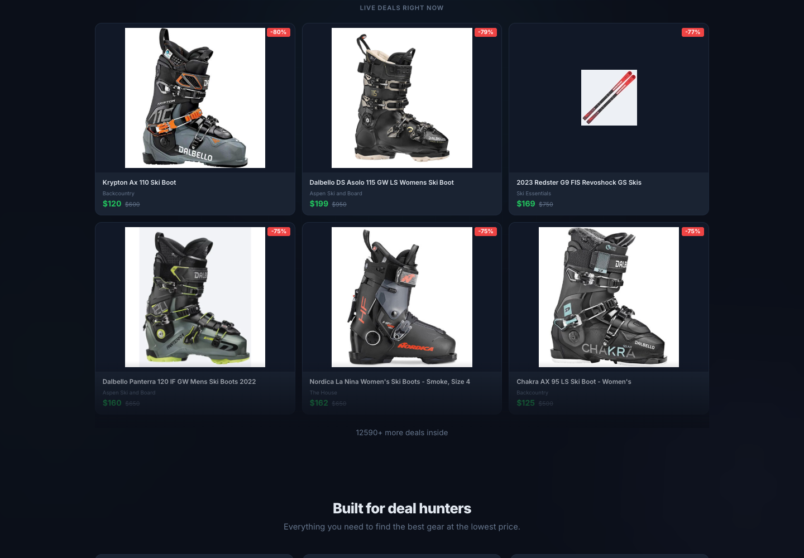

# Fresh Powder

Find deeply discounted ski and snowboard gear across specialist retailers, ranked by percentage off. Original price, sale price, and dollar savings make each opportunity visible; fit filters and expert reviews help shoppers decide whether to act.

[Existing live app](https://snow-deal.vercel.app) · [Shared methodology](../../docs/METHODOLOGY.md)



## Ownership

- `src/aggregator/`: snow taxonomy, retailer registry, model/brand rules, exclusion rules, browser/store adapters, review matching, database queries, auth, and FastAPI/Jinja2/htmx UI.
- `src/snow_deals/`: existing secondary CLI and BlueZone parser. Shared parser/model imports are retained as compatibility shims.
- `tests/`: category and app regression tests.
- `deploy/`: Dockerfile and Render startup script.
- `tampermonkey/`: existing userscript.
- `PLAN.md`, `GTM.md`, `EVALUATION.md`: preserved product planning and evaluation records.
- `history/aggregator/`: preserved former aggregator README, plans, findings, evaluation, and package metadata. Historical paths, metrics, and deployment statements there are not current instructions.

`deal_common` provides reusable models, platform parsing, HTTP pagination, cleanup, and rate limiting. Review matching remains precomputed. The UI and schema retain snow-specific length and category behavior.

## Setup and checks

Run from the workspace root, not this directory:

```bash
.venv/bin/python -m pip install -e '.[dev]'
.venv/bin/python scripts/check.py -q
PUBLIC_MODE=1 .venv/bin/uvicorn aggregator.web.app:create_app --factory --reload
```

The root installation supplies both `snow-deals` and `snow-deals-agg`. Existing Python imports (`aggregator.*`, `snow_deals.*`) are retained. Do not install the archived `history/aggregator/pyproject.toml`.

## Data and deployment

Default local data paths are `catalogs/fresh-powder/data/deals.db` and `catalogs/fresh-powder/data/auth.db`. They are created only when the app or CLI intentionally initializes a database. `DATABASE_PATH` and `AUTH_DB_PATH` override the defaults. Existing databases at old paths were not moved or read by the refactor; explicitly configure their absolute paths if needed.

Auth uses Turso when configured and local SQLite for development. `PUBLIC_MODE=1` bypasses invite gating; gated mode requires `SECRET_KEY`. Never commit those secrets or local data.

The checked-in `.github/workflows/scrape.yml` runs daily at 05:17 UTC. It installs from the workspace root, verifies parser/data contracts, restores the prior snapshot/history, and runs the scraper with completeness gates. Reports include variant and confirmed-size coverage. Reviews refresh on Sundays or explicit request. Successful runs publish the snapshot from the catalog data path. This is configuration, not evidence of a recent successful scrape.

Vercel still uses root `app.py`/`api/index.py`. `scripts/vercel_build.py` copies this catalog's static assets into `public/static` and downloads the snapshot into its new data path. Web serving remains read-only in Vercel. `render.yaml` points at `deploy/Dockerfile` with the workspace root as Docker context.

Build/download scripts, live scrapes, invite generation, auth synchronization, and deployment commands are operational actions, not generic validation. Source changes were checked offline and against a bounded public Aspen feed sample and merchant pages. No full live refresh, publication, or deployment was performed for this implementation. Existing snapshots require schema migration plus a fresh variant scrape before they can support exact-size search; see the [implementation receipt](../../docs/research/2026-11-02-deal-site-landscape/execution/IMPLEMENTATION.md).
